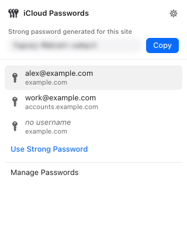
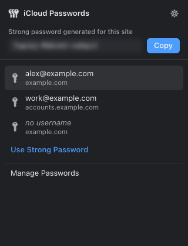
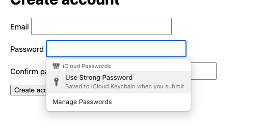
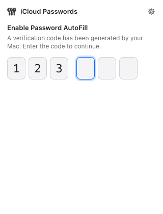

# iCloud Passwords+

A patch for Apple's **iCloud Passwords** extension for Brave and other Chromium browsers. It gives the extension a native-feeling popup, suggests strong passwords without opening the Passwords app, and fixes a set of bugs.

This repository does **not** contain Apple's code. `build.mjs` downloads the official extension from the Chrome Web Store, applies the changes in [`patches/`](patches/) and [`overlay/`](overlay/), and writes the result to `dist/`. The build keeps Apple's extension ID, so macOS's built-in password helper accepts it like the store version.

<p>
  
  
</p>
<p>
  
  
</p>

## What changes

**Popup**
- Restyled as a native light/dark bubble: system font, compact rows, settings button, no fake title bar or close button.
- The popup re-rendered whenever it regained focus, which wiped a half-typed code and made the list flicker. It no longer does.
- Every iframe on the page raced to overwrite the popup. It now picks one frame: the top frame first, then the most relevant form.
- Pressing Enter with nothing selected closed the popup. It no longer does.
- Closing the popup (for example, to read the code on your Mac) no longer cancels the pending code.
- A wrong code now says so, and a new code is sent automatically.
- Removed the "Open This Page in Safari" rows.

**Strong passwords, without the Passwords app**
- On sign-up and change-password fields, the in-page list and the popup offer **Use Strong Password**.
- Passwords are generated locally with `crypto.getRandomValues` in Safari's format (`xxxxxx-xxxxxx-xxxxxx`, about 71 bits). When the site's [`passwordrules`](https://developer.apple.com/password-rules/) or `maxlength` don't allow that format, a compliant password is generated instead.
- The password and confirm fields are filled through Apple's own fill path. The extension's existing save-on-submit flow then stores the password in iCloud Keychain.
- The last generated password for each site stays in session memory until the browser quits. The popup shows it blurred with a **Copy** button, in case a site's submit isn't detected.
- It's only offered once the extension is paired, so it never generates a password that can't be saved.

**In-page list and bug fixes**
- Opaque native dropdown instead of the translucent macOS panel. The dark-mode colors now update correctly when the theme changes.
- The list ran a do-nothing check every few milliseconds while it was open. That busy loop is gone.
- Usernames containing `&`, `#` or `%` broke the list. Fixed.
- Apple's build calls `parsePasswordRules` but never ships it, so reading a form threw on any page whose password field has a `passwordrules` attribute. That call is now guarded.
- While a code is pending, the list offers pairing instead of failing silently.

## Install

You need macOS with iCloud Keychain, a Chromium browser where Apple's extension already works, [Node.js](https://nodejs.org) 18 or later, and git.

```bash
git clone https://github.com/jvallejoarguez/icloud-passwords-plus.git
cd icloud-passwords-plus
node build.mjs
```

1. Open your browser's extensions page (`brave://extensions`, `chrome://extensions`, …) and turn on **Developer mode**.
2. Remove the Web Store **iCloud Passwords**. Both copies share one ID, so the browser won't load both.
3. Click **Load unpacked** and pick the `dist` folder.
4. Click the toolbar key and enter the code your Mac shows.

Unpacked extensions don't auto-update. To pick up Apple's latest version, run `git pull && node build.mjs`, then click reload on the extensions page. If Apple changes the code enough that the patch no longer applies, the build stops with a message. Please open an issue when that happens.

## How it works

The extension talks to macOS's `PasswordManagerBrowserExtensionHelper` through Chrome native messaging. Each browser session is unlocked with a 6-digit code (an SRP key exchange). A content script classifies forms, shows the in-page list in an extension iframe, and saves credentials when a form is submitted.

The build pins Prettier 3.3.3 to format Apple's minified sources so the patch applies with readable context. It also replaces `page_popup.html` and `style.css`, adds the new strings for English and Spanish, and renames the extension to "iCloud Passwords+".

## License

The build script, patch, overlay files and screenshots are under the [MIT License](LICENSE). Apple's extension is downloaded from the Chrome Web Store at build time and stays under Apple's terms.

Not affiliated with or endorsed by Apple Inc. iCloud and iCloud Keychain are trademarks of Apple Inc.
